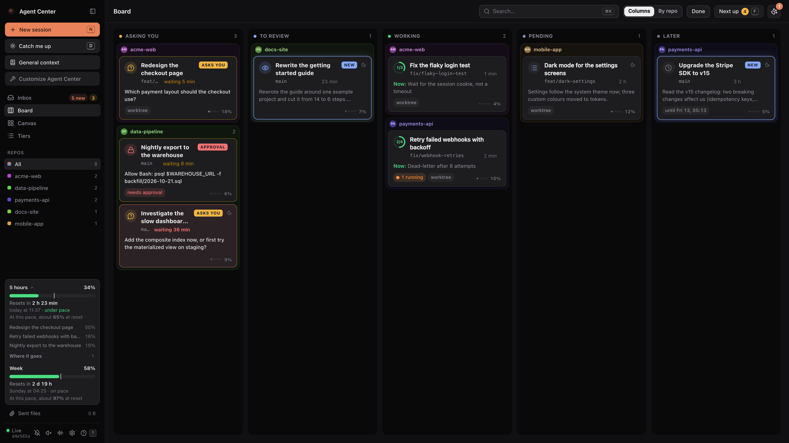
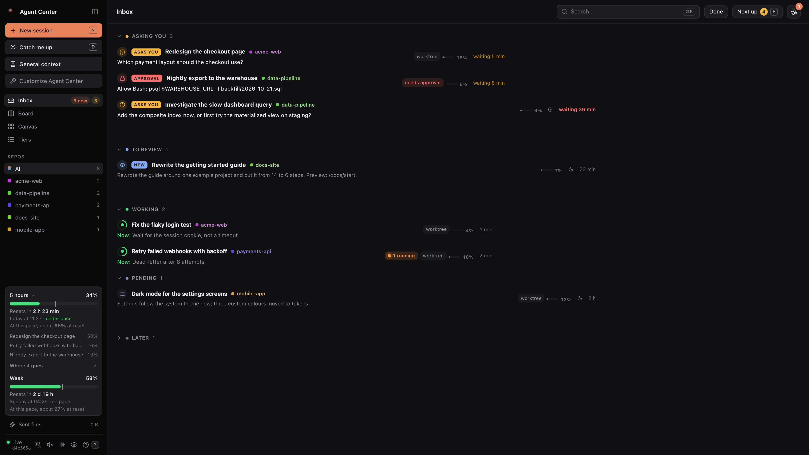
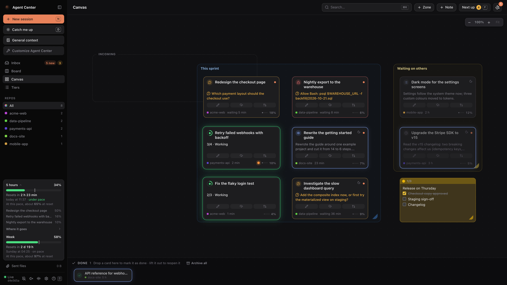
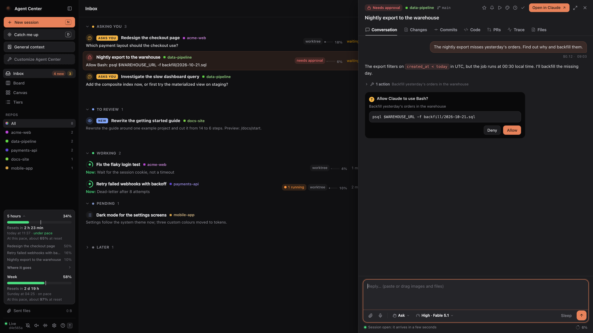
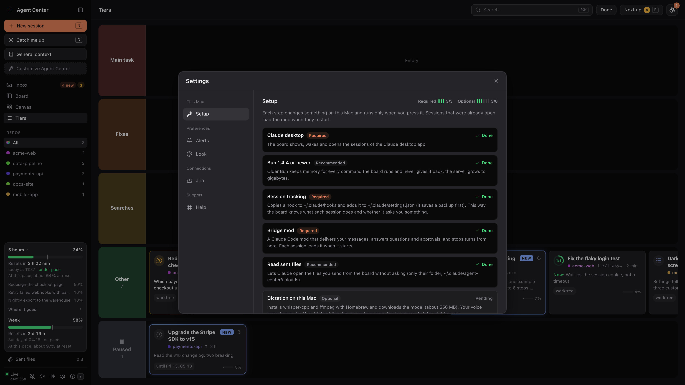

# Agent Center

A local board for every Claude Code session you run in the Claude desktop app on your Mac.
See which sessions ask you something, which finished and which still work, and answer, steer
and tidy them up from one page.

It runs on your Mac only. It reads the files Claude Code already writes, talks to your sessions
through a small Claude Code plugin (the *bridge mod*), and keeps its own state in a folder of
its own.



## What it does

- **Every session on one page.** Four views of the same sessions: Inbox (a list by state),
  Board (columns: Asking you, To review, Working, Pending, Later, Done), Canvas (cards you place
  freely, with zones and sticky notes) and Tiers (a ranking by importance).
- **Reply without switching windows.** Read a conversation as it is written, reply, attach files,
  dictate with Whisper on your Mac, answer questions and tool approvals, stop a turn, and change
  the mode, model and effort of a session.
- **Sleeping sessions wake up.** A message to a session Claude desktop has put to sleep wakes it
  in the background. When the app runs no more sessions, the board runs the turn itself.
- **The work around a session.** Its diff with line comments, its pull requests and checks, its
  git history, its files, a code editor (Monaco), and a timeline of each turn (Trace).
- **What it costs.** Context and cost per session, your plan's 5-hour and weekly limits, and
  where the tokens went. A conversation that grew too costly says so, with a way to compact
  it or to start fresh from a handoff note.
- **Jira and a delivery pipeline (optional).** Your Jira tickets on the board, sessions linked to
  them, and a pipeline of agents that takes a ticket from refinement to production, stopping
  wherever a person must decide.

The complete list, one line per feature, is in [FEATURES.md](FEATURES.md). The app shows that
list as its guide (press `?`).

| | |
|---|---|
|  |  |
| **Inbox**: what needs you first | **Canvas**: your own layout, zones and notes |
|  |  |
| **Conversation**: read, reply and answer | **Setup**: each step runs only when you press it |

## Quick start

You need macOS, the [Claude desktop app](https://claude.ai/download) (with its Code tab used at
least once), [Bun](https://bun.sh) and Python 3.8 or later.

```bash
git clone https://github.com/caaarlxs/agent-center.git
cd agent-center
./install.sh
```

The installer builds the page, starts the server as a launchd agent and opens
<http://localhost:7777>. The **Setup** dialog then opens. Each step says what it changes and
runs only when you press it.

To update, run `git pull` and press **Update** on the board. To remove it, run `./uninstall.sh`.

## Documentation

| Document | What it covers |
|---|---|
| [Install and update](docs/install.md) | Requirements, each Setup step, updates, uninstall |
| [Using the board](docs/usage.md) | The views, a conversation, sessions, costs, keyboard shortcuts |
| [Pipeline](docs/pipeline.md) | The agents that take a Jira ticket to production, and how to set them up |
| [Configuration](docs/configuration.md) | Environment variables and `settings.json` |
| [Privacy and security](docs/privacy.md) | What stays on your Mac, what goes out, and how the server is guarded |
| [Troubleshooting](docs/troubleshooting.md) | Messages that do not arrive, sessions that do not wake, logs |
| [Architecture](docs/architecture.md) | How the hook, the bridge mod, the server and the page fit together |
| [Contributing](CONTRIBUTING.md) | Development setup, checks and conventions |

## Limits

- macOS and the Claude desktop app only. The board reads the app's session records and its log,
  and uses its `claude://` links. None of these are a documented interface: a new version of the
  app can change them.
- The bridge mod uses Claude Code's plugin hooks API, which is in early access.
- Costs are shown at API prices. They approximate how fast you use your plan's limits; they are
  not what you pay.

## License

MIT: see [LICENSE](LICENSE). Third-party code and assets keep their own licences: see
[Credits](docs/architecture.md#credits).
