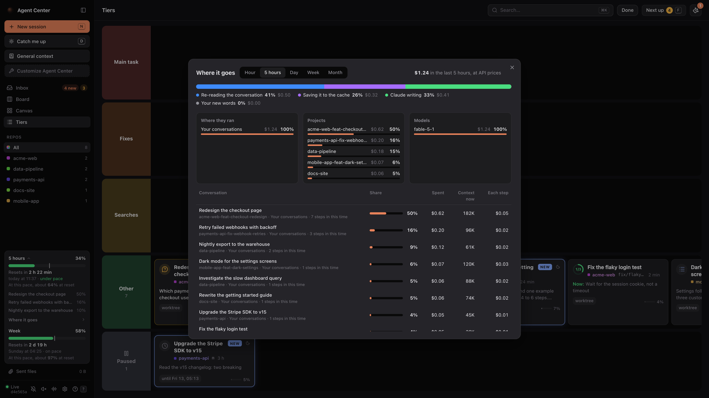

# Using the board

This page explains how the board works. For every feature in one line each, see
[FEATURES.md](../FEATURES.md), or press `?` in the app.

## The views

All views show the same sessions. A session's place follows what it waits for.

| View | Key | What it shows |
|---|---|---|
| Inbox | `1` | A list grouped by state: what needs you comes first. |
| Board | `2` | Columns: Asking you, To review, Working, Pending, Later, Done. Drag a card to move it. `G` splits the board into lanes, one per repository. |
| Canvas | `3` | Cards you place freely, with named zones, sticky notes (with checklists), zoom and multi-select. |
| Tiers | `4` | A ranking of your sessions by importance: Main task, Fixes, Searches, Other. Activity never reorders it. |
| Tickets | | Your Jira tickets on your team's board columns. Needs [Jira](install.md#alerts-look-and-jira). |
| Pipeline | | Tickets taken through the [Pipeline](pipeline.md) by agents. |

**Next up** (`F`) opens what waits for you next, with its reply box ready: approvals first, then
questions (the oldest first), then what is new to review.

**Catch me up** (`D`) writes one line per session about what happened since you last looked.
Claude writes it in a separate call that does not touch your sessions.

**Search** (`/` or `⌘K`) finds words in every conversation you had, archived ones included.

## A conversation

Click a card, or press `↵`, to open its conversation beside the board. It follows the session
live: Claude's answer shows as it is written.

- **Reply** as if you typed in Claude. A message waits 5 seconds, and while a turn runs, so you
  can take it back. Attach images, PDFs or any other file, or dictate.
- **Answer** questions with options and tool approvals ("Allow Bash: …") on the card or in the
  conversation. The dialog in Claude closes by itself.
- **Stop** a running turn (`S`), and change the permission mode, model and effort from the reply
  box.
- **Fork** the conversation from any of your messages into a new session.
- **Run** shell blocks on your Mac, if you turned on Run commands in Setup.

### A session's tabs

| Tab | What it shows |
|---|---|
| Conversation | The messages, tool calls folded into one line per turn, files changed, and what each turn cost. |
| Changes | The diff against the base branch, with line comments sent back as one message. |
| Commits | The git history of every repository the session touched. |
| Code | The repository in an editor (Monaco), with `⌘S` to save, `⌘P` to open a file, `⌘⇧F` to search. |
| PRs | The session's pull requests, their checks, review state and comments, and a merge button. Needs `gh`. |
| Files | The files Claude sent, published or wrote, with a viewer. |
| Ticket | The Jira ticket the session works on: description, comments, status. Needs Jira. |
| Trace | One turn on a timeline: each model call, tool call, subagent and wait, with tokens and cost. |
| Tasks | The project's task list, if you turned on Tasks in Setup. |

## Sessions

- **New session** (`N`) starts a session in any folder, with a first prompt, files, mode, model
  and effort, optionally in a new git worktree. The first turn runs headless, then the session
  moves into Claude desktop.
- **Sleeping sessions.** Claude desktop stops idle sessions to save memory. A message to one wakes
  it in the background. When the app runs as many sessions as the Mac's memory allows, the board
  runs the turn itself, headless, in the same session (marked "headless").
- **Overlaps.** A card warns when another open session edited the same files in the last hours,
  or works in the same folder right now.
- **Memory.** A card shows what its session takes in memory from 1 GB. The sidebar finds
  commands left running for hours that nobody uses, and stops them with one click.

## Costs and limits

All costs are at API prices. They show how fast you use your plan; they are not what you pay.

- **Plan limits** in the sidebar: how much of your 5-hour and weekly windows is used, when each
  resets, and where you get at this pace.
- **Where it goes** (under the limits): what your tokens went on in the last hour, 5 hours, day,
  week or month, by kind, origin, model, project and conversation.

  

- **A costly conversation** shows a note over its reply box:
  - When each step re-reads more than 400K tokens and its cache is alive, **Compact** sends
    `/compact`. The same model writes a summary, for a few cents.
  - When it has been idle for more than an hour and holds 200K tokens or more, its cache has
    expired: the next message writes all of it again. **Start fresh** starts a new session from a
    handoff note instead, without waking the old one.

## Keyboard

| Keys | Action |
|---|---|
| `J` `K`, `↓` `↑` | Move between sessions |
| `↵` | Open the conversation |
| `R` | Reply |
| `T` | Rename |
| `O` | Open in Claude |
| `P` | Pin |
| `C`, then `0`–`7` | Colour the card (`0` takes it off) |
| `A`, then `1`–`5` | Later: pick when |
| `E` | Mark as done; on a done card, reopen |
| `U` | Mark to review |
| `S` | Stop the running turn |
| `Z` | Undo |
| `/`, `⌘K` | Search |
| `1` `2` `3` `4` | Inbox, Board, Canvas, Tiers |
| `[` `]` | Tiers: the selected card one row up, down |
| `<` `>` | Tiers: the selected card one place left, right |
| `G` | Lanes per repository (Board) |
| `F` | Next up |
| `L` | The last session that finished or asked |
| `N` | New session |
| `D` | Catch me up |
| `+` `−` `0` | Canvas: zoom in, zoom out, fit |
| `Space` + drag | Canvas: move the view |
| `?` | The guide |
| `Esc` | Close |
